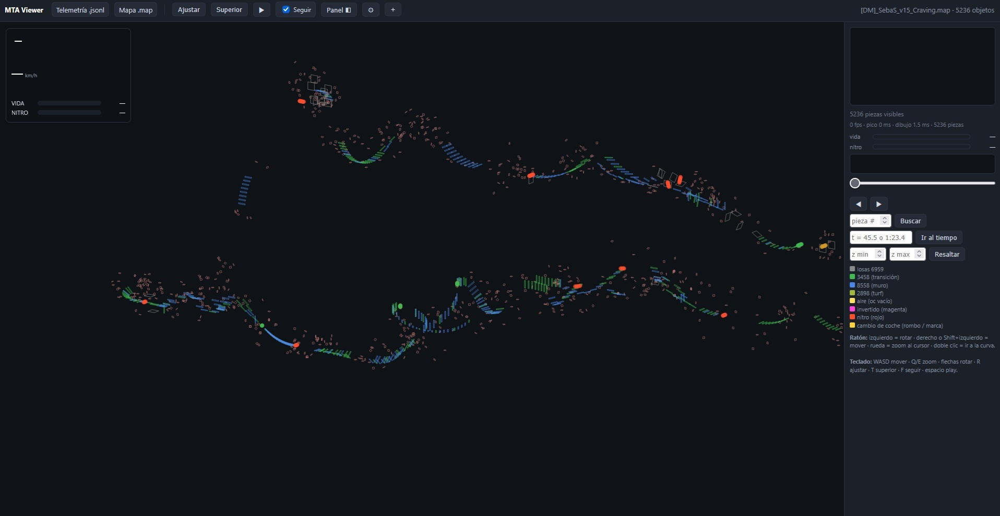
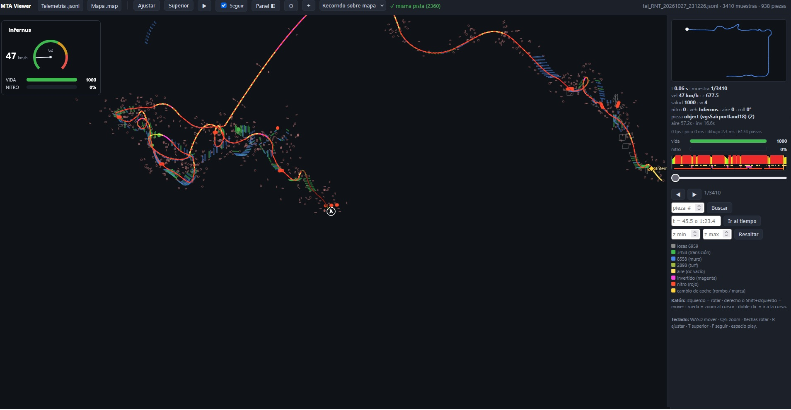

# MTA:SA Telemetry + Viewer

Grabador de telemetria a **20 Hz** y **visor web estatico** para mapas `race` / `DM` de
Multi Theft Auto: San Andreas.

- Sin base de datos: cada grabacion es un `.jsonl` (una muestra por linea).
- Visor 100% estatico: un `index.html` + un `viewer.js`, se abre con doble clic.
- Warps con marcas, persistencia por jugador y restauracion exacta (auto, nitro, salud).
- Pensado para analizar uniones, saltos, caidas y fases de vehiculo (coche vs Hunter 425).

## Estructura

```
telemetry/      resource de MTA (meta.xml + client.lua + server.lua)
viewer/         visor web (index.html + viewer.js)
```

## Instalación

### Telemetria (server)

1. Copia `telemetry/` a `mods/deathmatch/resources/telemetry/`.
2. En la consola: `refresh` y `start telemetry`.

### Visor

1. Abri `viewer/index.html` en el navegador (no necesita servidor).
2. Carga un `.jsonl` con el selector de archivos.
3. Opcional: carga el `.map` del mismo mapa para ver la pista debajo del recorrido.

## Cómo captura

- Un `setTimer` cada **50 ms** (20 Hz) llama a `sample()`.
- Cada muestra es una linea JSON (JSONL):
  - `t` ms, `x/y/z`, `rx/ry/rz` (Euler), `vx/vy/vz`, `s` (km/h), `h` (salud),
  - `w` (ruedas en contacto), `nit/nitc/nitl/nitk` (nitro), `veh` (modelo),
  - `gear`, `air` (flechas), `thr/brk/str/hb`,
  - `oc` (nombre del objeto en contacto), `om` (modelo del contacto), `ox/oy/oz` (posicion),
  - `bx1..bz2` (caja del vehiculo), `o1..o4` (ruedas).
- La **primera linea** es `meta`: jugador, vehiculo, `map` (tag del mapa), fecha.
- El archivo se guarda como `tel_<jugador>_<fecha>.jsonl` dentro de una **carpeta por mapa**
  (`<TAG_DEL_MAPA>/`), asi los intentos del mismo mapa quedan juntos.
- Los **warps** se guardan aparte, en `warps_<jugador>.json`.

## Comandos

| comando | accion |
|---|---|
| `/ts [tag]` | empezar a grabar (etiqueta opcional) |
| `/tx` | parar y guardar |
| F7 o E+K | grabar / parar |
| `/t?` | estado |
| `/tba` | borrar la grabacion actual |
| `1` / `2` / `3` | warp: guardar / cargar / eliminar |
| `/wsa` `/wld` `/wdl` `/wstatus` | idem por comando |

## Warps

Guardan: posicion, rotacion, velocidad, salud, salud del jugador, **nitro exacto**
(cantidad, nivel y si estaba encendido) y **modelo del vehiculo**.

Al cargar:
- restaura el auto del momento del warp (Infernus, Sultan, Sandking, Hunter),
- aplica el nitro exacto (incluye "sin nitro": count 0),
- **rebobina** la grabacion hasta la muestra del warp (no borra el warp),
- inserta una marca `{"type":"warp","t":...]` para que el analisis excluya solo ese instante,
- reanuda el muestreo 0.5 s despues, continuando el tiempo desde el warp.

### Auditoria v1.0.0 (bugs encontrados y corregidos)

1. **Reanudacion rota**: el timer comprobaba `isElement(veh)` (global que puede quedar
   viejo) en vez del vehiculo capturado `v`; si `veh` era `nil`, el timer no reanudaba y
   `pausedWarp` quedaba en `true` para siempre (grabacion muerta tras el warp).
   *Fix: `isElement(v)`.*
2. **Lista compartida sin sanear**: `warps = list` tomaba la tabla del server tal cual, sin
   validar y compartiendo referencia. *Fix: se reconstruye validando `x/y/z`.*
3. **Sin limite de warps**: la lista crecia sin tope (llegamos a 60+). *Fix: cap 50 FIFO.*
4. **Modelo reseteaba el nitro**: `setElementModel` se llamaba siempre al cargar, incluso
   con el mismo modelo, y eso resetea nitro/componentes. *Fix: solo si el modelo difiere.*
5. **Archivo anidado `[[...]]`**: el server podia guardar la lista envuelta; el cliente
   ya la desenvuelve, y ahora el server tambien **sanea y guarda un array plano**.

## Visor

- **HUD**: vida, nitro y velocidad con **tacómetro** (3 modos en Ajustes:
  *solo número*, *numero + tacómetro*, *tacómetro con numero*).
- **Linea de tiempo**: velocidad, aire, invertido, nitro y cambios de coche.
- **Busqueda** por pieza (`oc`) y por **tiempo** (`45.5`, `1:23.4`).
- **Ajustes** persistentes (localStorage): marcador flecha/coche/coche 3D, calidad, mapa.
- Los iconos/modelos del coche se pueden activar con el marcador "Coche" / "Coche 3D".

## Qué puedes cargar?

El visor acepta **tres combinaciones**:

- **Solo el .map** de MTA: dibuja la pista (los objetos del mapa).
- **Solo el .jsonl** de telemetry: dibuja el recorrido, el HUD y las piezas que toco el coche.
- **Los dos a la vez**: si son del mismo mapa, se **aceptan** y se **superponen** para verlos
  en conjunto (mapa de fondo + recorrido encima).

Cuando cargas ambos, el visor compara los IDs de las piezas del mapa con las que toco el
coche en la telemetria:

- **misma pista** (marca verde): se muestra el mapa y se superpone la telemetria.
- **no coinciden** (marca roja): el mapa se oculta y queda solo la telemetria.

Podes prender/apagar cada capa en **Ajustes -> Mapa / Telemetria**.

## Compatibilidad con el servidor

- Gamemode `race`; un **DM** es un mapa race **sin checkpoints**.
- `getRunningGamemodeMap()` + `getResourceName` dan el **tag del mapa** que se usa para la
  carpeta y para el visor.
- La muestra incluye `veh`: el analisis separa **fase coche** de **fase Hunter (modelo 425)**,
  que es la pelea final cuando terminan dos o mas.

## Cambios recientes

- **v1.0.1**
  - `meta.title`: el servidor guarda el nombre del mapa (`<info name>`) y el visor lo
    muestra en el HUD.
  - Si la telemetría no trae mapa, el visor usa el nombre del `.map` cargado.
  - El servidor recuerda el último mapa si `getRunningGamemodeMap()` falla.
  - **Warps de sesión**: se limpian al reiniciar la sesión y al cambiar de mapa.
  - Correcciones de warps (reanudación, lista, límite, modelo, archivo anidado).

## Pruebalo

- **En linea**: https://mplstudio.net/v-1a601cef/ (la carpeta puede cambiar si se regenera)
- **Local**: abri `viewer/index.html` en el navegador y carga un `.jsonl`

## Capturas

Mapa renderizado por el visor (preview):






## ¿Qué sigue?

- **Rankings por mapa**: compatibilidad para guardar el recorrido y actualizarlo en las paginas web de los servers.
- **Viewer**: mejorar visibilidad y manejo (HUD, navegacion, rendimiento).
- **Vehiculos**: agregar modelos de otros vehiculos.
- **Estructuras**: agregar estructuras mas detalladas.
- **Capturas del mapa**: opcion de exportar la vista del visor (o el render del mapa) a PNG con un clic.

Asi el usuario sabe que esperar de las proximas versiones.
## Licencia

MIT. Ver `LICENSE`.
